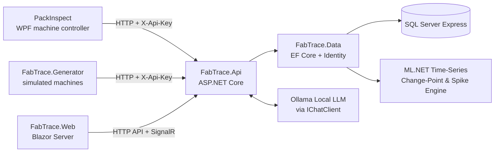

# FabTrace – Architecture

State after phase 6 (Predictive Maintenance & ML.NET Time-Series Anomaly Detection). Later phases add to this document.

## Overview



## Project dependencies

```
Contracts  <-  Core  <-  Data  <-  Api
                 ^
                 +-----  Generator
```

- **Contracts** has no dependencies, so a machine project can reference it alone.
- **Core** holds entities, interfaces and pure logic. It does not know about EF Core or HTTP.
- **Data** implements Core's interfaces with EF Core. There is no repository layer: `DbContext` already is a unit of work.
- **Api** contains only HTTP concerns: authentication, validation, mapping outcomes to status codes.

## Ingestion request, step by step

1. Machine posts a batch to `POST /api/ingest/inspection-results` with header `X-Api-Key`.
2. `ApiKeyAuthenticationHandler` hashes the key (SHA-256), finds the active machine with that hash, and puts its id in the request's claims.
3. `[ApiController]` validates the DTOs (required fields, lengths, enum values). A malformed body is a 400 for the whole request.
4. `IngestController` checks the batch size (1 to 1000) and calls `IIngestionService` with the machine id from the claims.
5. `IngestionService`:
   - asks SQL Server which `ResultId`s it already has (those become `Duplicate`);
   - loads the steps, recipes, operators, lots and units the batch names;
   - rejects items with unknown master data or a serial number that belongs to another lot (`Rejected` with a reason);
   - creates lots and units seen for the first time;
   - saves everything in one `SaveChanges`, which is one transaction.
6. If a concurrent request inserted the same row first, the unique index raises error 2601/2627. The service clears its pending changes and repeats step 5; the second pass sees the other request's rows.
7. The response lists `Created`, `Duplicate` or `Rejected` per item, in order.

## Design decisions

| Decision | Reason |
|---|---|
| Idempotency key generated by the machine, enforced by a unique index | A machine that never got the answer can resend safely; the database, not the code, gives the guarantee |
| Per-item outcome instead of failing the batch | One bad result must not block 499 good ones; a store-and-forward queue knows exactly what to delete |
| Machine identity from the API key | A machine cannot report data as another machine |
| API key stored as SHA-256 hash | A leaked database does not leak usable keys |
| Lots and units created on first sight | The floor is the source of truth for what was produced; master data (recipes, operators, steps) must already exist |
| Machine state stored as transitions without an end time | No two rows can disagree; durations come from `LEAD()` in phase 3 |
| UTC `datetime2(3)` everywhere | No ambiguity across shifts or machines; milliseconds are enough and save a byte per value |
| Enums as `tinyint` with `CHECK` constraints | Small rows, and invalid values are impossible even from raw SQL |
| Surrogate identity keys plus unique natural keys | Narrow foreign keys and clustered indexes on tables that grow without limit |
| Reporting indexes added in Phase 3 | Cover `(InspectedAt, MachineId)`, `(RecipeId, Verdict)`, `(MachineId, StartedAt)` for high-throughput range aggregation |
| SQL Server stored procedures for reporting | Heavy analytics (`LEAD()` for state durations, yield rollups, OEE) run in the database engine without pulling millions of rows into C# memory |
| Migrations applied on startup only in Development | Production schema changes should be a deliberate step |
| Controllers, not minimal APIs | The structure most enterprise C# teams use |
| Generator talks to the API, not the database | It exercises the same path as a real machine |
| Machine store-and-forward disk queue (in PackInspect, a separate repository) | Network drops do not block machine cycles; results persist in local `pending/` and flush upon recovery |
| Rejected outcome issue log (in PackInspect) | Items rejected by the server (e.g. unknown recipe/step) are isolated in `issues/` and logged without blocking valid items |
| Read-only parameterised C# tools for AI | AI never generates or runs raw SQL; it only invokes approved, strongly typed C# functions calling existing application services |
| Data transparency on AI answers | Every assistant response captures and displays the exact tool outputs and raw records used as evidence |
| ML.NET TimeSeries on-device anomaly detection | Pure .NET 10 solution without Python dependencies; evaluates parametric sensor drift using Martingale scoring |
| Predictive maintenance tool integration for AI Assistant | AI Assistant can invoke time-series change-point pipelines to proactively flag equipment wear for engineers |

## Generator

`FactorySimulator` is pure and deterministic (one seeded `Random`, no clock, no I/O) and yields events; `ApiPublisher` batches them per machine and posts them. Event ids are derived from what the event is (`result|serial|step`), so a replay sends the same ids.

Planted problems in the default four-week history:

| Problem | When | Signature |
|---|---|---|
| Bad recipe `BOND-QFN32` v2 (ultrasonic power lowered) | days 15 to 18 | Wire-bond fail rate about 2% to about 15%, defect `WIRE_LIFT`, both bonders, QFN32 only |
| Worn socket on tester `FT-02` | days 19 to 26 | `ContactResistance` drifts up, fail rate climbs daily to about 25%, ends with alarm `SOCKET_CONTACT_FAIL`, downtime and maintenance |
