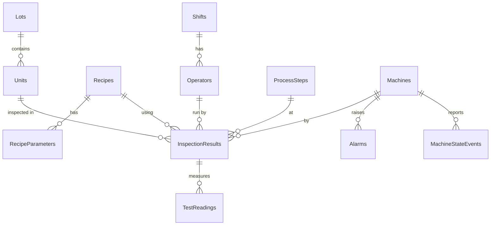

# FabTrace – Data model

Database `FabTrace` on SQL Server Express (`FabTrace_Test` for tests). Schema is owned by the EF Core migrations in `src/FabTrace.Data/Migrations`.

## Relationships

## Master data (seeded, changes rarely)

| Table | Columns | Unique key |
|---|---|---|
| `Machines` | `MachineId` int PK, `Code`, `Name`, `MachineType`, `Line`, `ApiKeyHash` binary(32), `IsActive` | `Code`; `ApiKeyHash` |
| `Shifts` | `ShiftId` int PK, `Name`, `StartTime` time(0), `EndTime` time(0) (factory local time; may cross midnight) | `Name` |
| `Operators` | `OperatorId` int PK, `BadgeNo`, `Name`, `ShiftId` FK | `BadgeNo` |
| `ProcessSteps` | `ProcessStepId` int PK, `Code`, `Name`, `Sequence` | `Code` |
| `Recipes` | `RecipeId` int PK, `Code`, `Version`, `ProductCode` | (`Code`, `Version`) |
| `RecipeParameters` | `RecipeParameterId` int PK, `RecipeId` FK (cascade), `Name`, `Target` float, `LowerLimit`, `UpperLimit`, `Unit` | (`RecipeId`, `Name`) |

## Production data (written by machines, grows without limit)

| Table | Columns | Unique key |
|---|---|---|
| `Lots` | `LotId` int PK, `LotNumber`, `ProductCode`, `StartedAt` | `LotNumber` |
| `Units` | `UnitId` bigint PK, `SerialNumber`, `LotId` FK | `SerialNumber` |
| `InspectionResults` | `InspectionResultId` bigint PK, `ResultId` uniqueidentifier, `UnitId`, `ProcessStepId`, `MachineId`, `RecipeId`, `OperatorId` (FKs), `Verdict` tinyint, `DefectCode`, `InspectedAt`, `ReceivedAt`, `CycleTimeMs` | `ResultId` |
| `TestReadings` | `TestReadingId` bigint PK, `InspectionResultId` FK (cascade), `ParameterName`, `Value` float, `LowerLimit`, `UpperLimit`, `Unit` | |
| `Alarms` | `AlarmId` bigint PK, `EventId` uniqueidentifier, `MachineId` FK, `AlarmCode`, `Severity` tinyint, `Message`, `RaisedAt`, `ClearedAt` null | `EventId` |
| `MachineStateEvents` | `MachineStateEventId` bigint PK, `EventId` uniqueidentifier, `MachineId` FK, `State` tinyint, `StartedAt`, `ReasonCode` | `EventId` |

All timestamps are UTC `datetime2(3)`. Text columns are `nvarchar` sized by `FieldLengths` (codes 32, names 100, units 16, messages 200).

## Enum values (stored as tinyint; never renumber)

| Column | Values |
|---|---|
| `Verdict` | 1 Pass, 2 Fail |
| `Severity` | 1 Info, 2 Warning, 3 Critical |
| `State` | 1 Running, 2 Idle, 3 Down, 4 Setup, 5 Maintenance |

## Constraints

| Constraint | Rule |
|---|---|
| `CK_InspectionResults_Verdict` | `Verdict IN (1, 2)` |
| `CK_InspectionResults_CycleTimeMs` | `CycleTimeMs >= 0` |
| `CK_Alarms_Severity` | `Severity IN (1, 2, 3)` |
| `CK_Alarms_ClearedAfterRaised` | `ClearedAt IS NULL OR ClearedAt >= RaisedAt` |
| `CK_MachineStateEvents_State` | `State IN (1, 2, 3, 4, 5)` |
| Foreign keys | `NO ACTION` on delete, except readings of a result and parameters of a recipe (`CASCADE`) |

## Indexes in phase 1

Primary keys (clustered), the unique keys above, and one non-clustered index per foreign key (EF Core convention). No reporting indexes yet: they are added in phase 3 together with before/after query plans.

## API payloads

Defined in `src/FabTrace.Contracts`. Enums travel as text, timestamps as ISO 8601 with offset.

| Endpoint | Body | Answer |
|---|---|---|
| `POST /api/ingest/inspection-results` | `InspectionResultDto[]` (1 to 1000) | `IngestResponse` |
| `POST /api/ingest/alarms` | `AlarmDto[]` | `IngestResponse` |
| `POST /api/ingest/alarms/{eventId}/clear` | `ClearAlarmRequest` | 204, 404 or 400 |
| `POST /api/ingest/machine-states` | `MachineStateEventDto[]` | `IngestResponse` |
| `GET /api/machines` | | `MachineDto[]` |
| `GET /api/lots/{lotNumber}` | | `LotSummaryDto` or 404 |
| `GET /api/units/{serialNumber}` | | `UnitTraceDto` or 404 |
| `GET /health` | | 200 or 503 |

`IngestResponse.items[i]` is `{ id, status: Created | Duplicate | Rejected, error }` for the i-th item sent.
