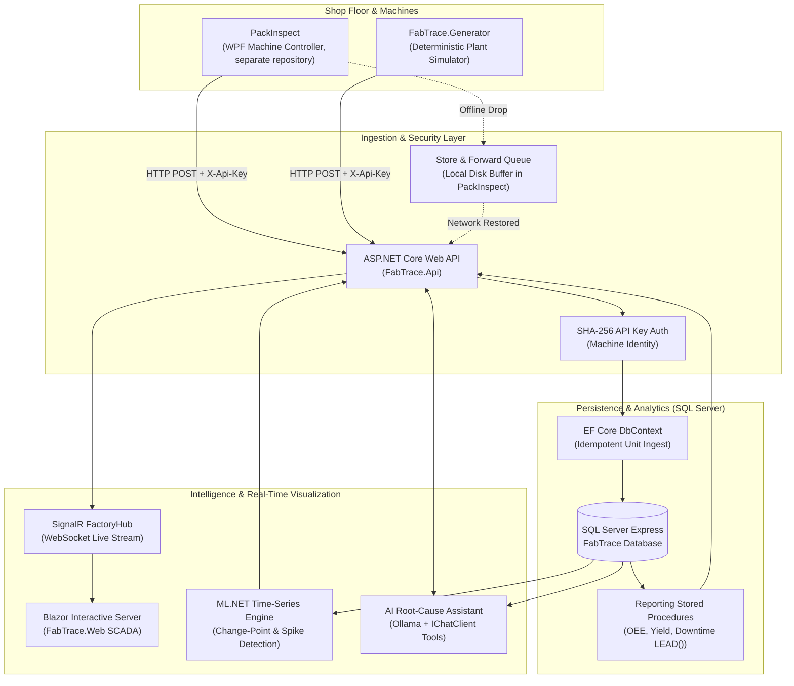

# FabTrace – Semiconductor Smart Factory & Traceability Platform

[](https://dotnet.microsoft.com/)
[](https://www.microsoft.com/sql-server)
[](https://github.com/luqshzeeq3601-art/fabtrace/actions/workflows/ci.yml)
[](LICENSE)

**FabTrace** is a reference smart factory platform designed for semiconductor assembly and test facilities (OSAT & machine builders). It ingests high-speed inspection results from floor machines, guarantees idempotent storage, renders a real-time SCADA digital twin via SignalR, calculates factory OEE using T-SQL stored procedures, diagnoses root causes via a local LLM assistant, and performs on-device predictive maintenance using ML.NET time-series anomaly detection.

Designed as an explainable, enterprise-level C# showcase with real SQL Server features, zero cloud costs, and full test automation.

---

## Architecture Overview



---

## Key Features

### 1. High-Throughput Idempotent Ingestion
* **Client-Generated UUIDs**: Every inspection result and alarm carries a machine-generated `ResultId`/`EventId`.
* **Zero Duplication Guarantee**: SQL Server unique constraints ensure retried network transmissions never double-count parts or skew yield metrics.
* **Per-Item Status Reporting**: Batch responses return individual `Created`, `Duplicate`, or `Rejected` outcomes without failing entire 1,000-unit payloads.
* **Store-and-Forward (PackInspect)**: Lives in PackInspect, the companion WPF machine controller kept in a separate repository, not in this one. It buffers offline data on local disk so plant network disconnects never stall machine cycle rates. FabTrace supplies the server side that makes it safe: idempotent ingestion and per-item outcomes.

### 2. Live SCADA Floor View (Digital Twin)
* **Real-Time SignalR Streaming**: Pushes machine state changes (`Running`, `Idle`, `Down`, `Setup`, `Maintenance`) and alarm events with zero polling overhead.
* **Interactive Dashboard**: Role-based Blazor Web App (`Operator`, `Engineer`, `Admin`) with live throughput, shift yield counters, and active alarm bells.
* **Security & Roles**: ASP.NET Core Identity authentication with granular role authorization.

### 3. Traceability & SQL Server Analytics
* **Unit Traceability**: Instant end-to-end lookup displaying every process step, recipe parameters, operator, and parametric readings for any serial number.
* **High-Performance Stored Procedures**:
  * `sp_GetYieldReport`: Multi-step pass/fail yield rollups.
  * `sp_GetMachineDowntimeReport`: Exact state durations computed via windowed `LEAD()` functions.
  * `sp_GetOeeReport`: Overall Equipment Effectiveness factoring Availability, Performance, and Quality.
  * `sp_GetDefectPareto` & `sp_GetParametricDrift`: Defect Pareto rankings and parameter shifts.
* **Targeted Reporting Indexes**: Composite indexes on `(InspectedAt, MachineId)` and `(RecipeId, Verdict)` replacing table scans with index seeks; the before/after query plans are asserted in `PerformanceIndexTests`.

### 4. Predictive Maintenance with ML.NET
* **On-Device Machine Learning**: Native C# time-series analysis using `Microsoft.ML.TimeSeries` (no Python or external runtime needed).
* **Change-Point Detection**: Uses Martingale scoring and confidence intervals to detect subtle baseline drift in test readings (e.g. test socket wear).
* **Automated Alerting**: Recommends preventative maintenance before physical failure thresholds trigger line-stoppage alarms.

### 5. AI Root-Cause Diagnostic Assistant
* **Local Private LLM**: Powered by `Microsoft.Extensions.AI` and Ollama (`llama3.1` by default, configurable) through standard `IChatClient`.
* **Read-Only C# Tool Calling**: LLM accesses parameterized, type-safe C# diagnostic functions. **Never runs raw model-generated SQL**.
* **Evidence & Grounded Transparency**: Every diagnostic answer displays the exact underlying data records and tool outputs used as evidence.

---

## Planted Problem Scenarios

The simulator ([`FabTrace.Generator`](src/FabTrace.Generator)) replays a realistic 4-week factory history containing two real-world failure signatures:

| Scenario | Timeframe | Failure Signature | Root Cause |
|---|---|---|---|
| **Defective Recipe Version** | Days 15 to 18 | Wire bond yield drops from 98% to ~85% with `WIRE_LIFT` defects on QFN32 packages across both bonders. | Recipe `BOND-QFN32` v2 lowered ultrasonic power below specification limit. |
| **Degrading Tester Socket** | Days 19 to 26 | `ContactResistance` on tester `FT-02` progressively drifts upward until alarm `SOCKET_CONTACT_FAIL` causes unscheduled downtime. | Physical socket contact pin wear. Caught early by ML.NET time-series change point detector. |

---

## Technology Stack

| Layer | Technology | Rationale |
|---|---|---|
| **Runtime & Framework** | .NET 10 (C# 14) | Modern, high-performance LTS framework demanded by semiconductor manufacturers. |
| **Database** | SQL Server Express | Factory industry standard; showcases T-SQL stored procedures, windowing functions, and indexing. |
| **ORM & Persistence** | EF Core 10 | Enterprise standard for transactional CRUD and entity mapping. |
| **API & Hubs** | ASP.NET Core Web API + SignalR | Clean controller architecture and low-latency WebSockets. |
| **Frontend** | Blazor Web App (Interactive Server) | Live interactive C# UI without complex Node.js/JavaScript toolchains. |
| **Machine Learning** | ML.NET (`Microsoft.ML.TimeSeries`) | Pure C# on-device anomaly and change-point detection without Python dependencies. |
| **AI Assistant** | `Microsoft.Extensions.AI` + Ollama | Standardized FOSS AI abstraction with strict parameterised tool calling. |
| **Logging** | Serilog | Structured logging to console and daily rolling files; one line per request, tagged with the machine code. |
| **Testing** | xUnit v3 + `WebApplicationFactory` | Microsoft Testing Platform running 109 integration and unit tests against real SQL Server. |

---

## Solution Structure

```
FabTrace/
├── src/
│   ├── FabTrace.Contracts/      # Shared DTOs, routes, enums, validation limits (zero dependencies)
│   ├── FabTrace.Core/           # Domain entities, interfaces, factory master data, pure logic
│   ├── FabTrace.Data/           # EF Core context, SQL Server migrations, stored procedures, ML.NET service
│   ├── FabTrace.Api/            # HTTP endpoints, API-key authentication, SignalR hub, controllers
│   ├── FabTrace.Web/            # Interactive Blazor Server dashboard and live SCADA UI
│   └── FabTrace.Generator/      # Deterministic 4-week factory event generator and HTTP publisher
├── tests/
│   └── FabTrace.Tests/          # 109 xUnit v3 integration and unit tests against SQL Server
└── docs/
    ├── DATABASE.md              # Database ERD, table specs, stored procedures, and query plans
    ├── TEST-PLAN.md             # Complete test matrix, coverage, and verification methodology
    └── DEMO-SCRIPT.md           # Step-by-step interview demonstration walkthrough
```

---

## Quick Start

### Prerequisites
* [.NET 10 SDK](https://dotnet.microsoft.com/)
* SQL Server Express running locally at `.\SQLEXPRESS` with Windows Authentication. To use another instance, change `ConnectionStrings:FabTrace` in `src/FabTrace.Api/appsettings.json` and set `FABTRACE_TEST_CONNECTION` for the tests.
* *(Optional for AI tab)*: [Ollama](https://ollama.com/) running locally with the configured model (`ollama pull llama3.1`).

### 1. Build & Run Tests
```powershell
# Restore tools (installs dotnet-ef)
dotnet tool restore

# Build entire solution
dotnet build

# Run all 109 unit and integration tests (automatically prepares FabTrace_Test)
dotnet test
```

### 2. Start the Backend API
```powershell
dotnet run --project src/FabTrace.Api
# API runs at http://localhost:5080 (auto-migrates and seeds FabTrace database)
```

### 3. Generate Simulated Plant History
```powershell
# In a second terminal, replay 4 weeks of plant data with planted problems
dotnet run --project src/FabTrace.Generator -- --Weeks 4 --Seed 42
```

### 4. Launch the SCADA Dashboard
```powershell
dotnet run --project src/FabTrace.Web
# Open http://localhost:5176 in your browser
```

Log in or quick-switch using the pre-seeded demo accounts:
* **Operator**: `operator1` / `Operator123!` (Floor SCADA view, alarms, unit traceability)
* **Engineer**: `engineer1` / `Engineer123!` (Traceability, OEE reports, Root-Cause, ML.NET Predictive Maintenance, AI Assistant)
* **Admin**: `admin1` / `Admin123!` (Machine administration, API key rotation, full access)

These accounts and the `dev-key-<machine code>` API keys are seeded only in the Development environment. See [Security.md](Security.md).

---

## Configuration

Everything runs with the defaults. Override settings with environment variables or `dotnet user-secrets`, never by committing secrets.

| Setting | Default | Used by |
|---|---|---|
| `ConnectionStrings:FabTrace` | `.\SQLEXPRESS`, database `FabTrace`, Windows authentication | API |
| `FABTRACE_TEST_CONNECTION` (environment variable) | `.\SQLEXPRESS`, database `FabTrace_Test` | Tests |
| `Ollama:Endpoint` / `Ollama:Model` | `http://localhost:11434` / `llama3.1` | API (AI tab) |
| `Auth:TokenSigningKey` | Random per start in Development; required elsewhere | API |
| `Cors:AllowedOrigins` | `http://localhost:5176`, `https://localhost:7176` | API |
| `ApiBaseUrl` | `http://localhost:5080` | Web dashboard |

---

## Known Limitations

* **Demo data only**: all plant data comes from the simulator; no real factory data is included.
* **Development-first**: migrations, demo plant, and demo accounts are applied automatically only in the Development environment. There is no deployment setup.
* **PackInspect is separate**: the machine controller and its store-and-forward queue are not part of this repository; the generator stands in for it.
* **AI tab needs Ollama**: without a local Ollama model the assistant cannot answer; the rest of the dashboard is unaffected.
* **Simple user tokens**: the API signs its own HMAC bearer tokens that last 12 hours, with no refresh or revocation.
* **Local HTTP**: the default launch profiles use plain HTTP; put the API behind HTTPS anywhere else.

---

## Documentation

* [Database Architecture & Stored Procedures](docs/DATABASE.md)
* [Test Plan & Verification Matrix](docs/TEST-PLAN.md)
* [Interview Demonstration Walkthrough](docs/DEMO-SCRIPT.md)
* [System Design Decisions (ARCHITECTURE.md)](ARCHITECTURE.md)
* [Security Notes (Security.md)](Security.md)
* [Approved FOSS Packages & Tool Allowlist (Skills.md)](Skills.md)

## Licence

[MIT](LICENSE)
