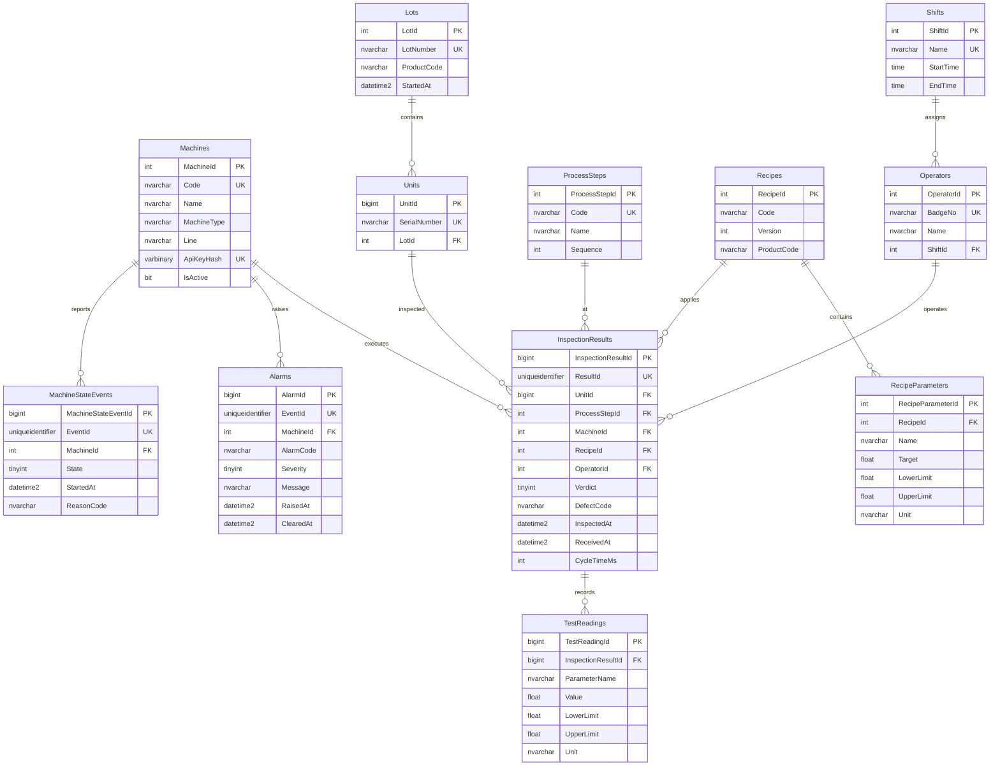

# FabTrace – Database Architecture & SQL Server Specification

The FabTrace database (`FabTrace` in production/demo, `FabTrace_Test` in tests) runs on SQL Server Express. The schema is defined and migrated using Entity Framework Core migrations in `src/FabTrace.Data/Migrations`.

---

## Entity-Relationship Diagram (ERD)



---

## Schema Design Principles

### 1. Narrow Types & BigInt Growth
* **Production Tables**: Use `bigint` surrogate primary keys (`UnitId`, `InspectionResultId`, `TestReadingId`, `AlarmId`, `MachineStateEventId`) to accommodate millions of transactions without overflow.
* **Enums as `tinyint`**: Stored as 1-byte integers (`Verdict`: 1=Pass, 2=Fail; `Severity`: 1=Info, 2=Warning, 3=Critical; `State`: 1=Running, 2=Idle, 3=Down, 4=Setup, 5=Maintenance) with database `CHECK` constraints.
* **Timestamps**: Precision `datetime2(3)` in UTC throughout all tables. Millisecond resolution guarantees ordering while saving 1 byte per row compared to `datetime2(7)`.

### 2. Idempotency & Concurrency Guarantees
* **Machine-Generated UUIDs**: Machines generate natural unique keys (`ResultId` for inspection results, `EventId` for alarms and state events).
* **Database Unique Constraints**: `UQ_InspectionResults_ResultId` and `UQ_Alarms_EventId`.
* **Rethrown Error Handling**: If two worker threads or network retries attempt to insert the same `ResultId`, SQL Server error 2601/2627 triggers. The ingestion service catches the collision, resets pending state, queries the database, and safely marks the duplicate as `Duplicate` with HTTP 200.

### 3. Constraints & Data Integrity
* `CK_InspectionResults_Verdict`: `[Verdict] IN (1, 2)`
* `CK_InspectionResults_CycleTimeMs`: `[CycleTimeMs] >= 0`
* `CK_Alarms_Severity`: `[Severity] IN (1, 2, 3)`
* `CK_Alarms_ClearedAfterRaised`: `[ClearedAt] IS NULL OR [ClearedAt] >= [RaisedAt]`
* `CK_MachineStateEvents_State`: `[State] IN (1, 2, 3, 4, 5)`
* **Foreign Keys**: `ON DELETE RESTRICT` (No Action) protects master data and unit history. Only parent-owned detail rows (`TestReadings` of `InspectionResults`, `RecipeParameters` of `Recipes`) use `ON DELETE CASCADE`.

---

## Stored Procedures

Heavy analytics are executed directly in the database engine using compiled T-SQL stored procedures, preventing the transfer of millions of raw records over the network to application memory.

### 1. `sp_GetMachineDowntimeReport` (State Duration via `LEAD()`)
State transitions only record `StartedAt` without an end time (preventing timestamp disagreements between adjacent rows). `sp_GetMachineDowntimeReport` uses the window function `LEAD()` partitioned by machine to compute exact durations across all states:

```sql
WITH Transitions AS (
    SELECT
        mse.MachineId,
        mse.State,
        mse.StartedAt,
        LEAD(mse.StartedAt, 1, @ToUtc) OVER (PARTITION BY mse.MachineId ORDER BY mse.StartedAt) AS NextStartedAt
    FROM MachineStateEvents mse
    WHERE mse.StartedAt >= @FromUtc AND mse.StartedAt <= @ToUtc
),
Durations AS (
    SELECT
        MachineId,
        State,
        DATEDIFF(second, StartedAt, NextStartedAt) AS DurationSeconds
    FROM Transitions
)
SELECT
    m.Code AS MachineCode,
    ISNULL(SUM(CASE WHEN d.State = 1 THEN d.DurationSeconds ELSE 0 END), 0) AS RunningSeconds,
    ISNULL(SUM(CASE WHEN d.State = 2 THEN d.DurationSeconds ELSE 0 END), 0) AS IdleSeconds,
    ISNULL(SUM(CASE WHEN d.State = 3 THEN d.DurationSeconds ELSE 0 END), 0) AS DownSeconds,
    ISNULL(SUM(CASE WHEN d.State = 4 THEN d.DurationSeconds ELSE 0 END), 0) AS SetupSeconds,
    ISNULL(SUM(CASE WHEN d.State = 5 THEN d.DurationSeconds ELSE 0 END), 0) AS MaintenanceSeconds,
    ISNULL(SUM(d.DurationSeconds), 0) AS TotalTrackedSeconds
FROM Machines m
LEFT JOIN Durations d ON m.MachineId = d.MachineId
WHERE (@MachineCode IS NULL OR m.Code = @MachineCode)
GROUP BY m.Code;
```

### 2. `sp_GetOeeReport`
Calculates Overall Equipment Effectiveness factors:
* **Availability**: `RunningSeconds / TotalSeconds`
* **Performance**: `(TotalUnits * TargetCycleTime) / RunningSeconds`
* **Quality**: `GoodUnits / TotalUnits`
* **OEE**: `Availability * Performance * Quality`

### 3. `sp_GetYieldReport`
Computes pass/fail yields grouped by machine, process step, and recipe version to immediately surface version-specific regressions.

### 4. `sp_GetDefectPareto`
Ranks defect codes with cumulative failure percentages to pinpoint primary scrap drivers.

### 5. `sp_GetParametricDrift`
Calculates daily parametric aggregates (`AvgValue`, `MinValue`, `MaxValue`, `UpperLimit`) for analog sensor readings like `ContactResistance`.

---

## Indexing Strategy

Phase 3 introduced dedicated covering reporting indexes:

| Table | Index Name | Columns | Purpose |
|---|---|---|---|
| `InspectionResults` | `IX_InspectionResults_InspectedAt_MachineId` | `(InspectedAt, MachineId)` | Optimizes date-range yield and throughput scans; eliminates table scans. |
| `InspectionResults` | `IX_InspectionResults_RecipeId_Verdict` | `(RecipeId, Verdict)` | Accelerates recipe version comparison and yield rollups. |
| `MachineStateEvents` | `IX_MachineStateEvents_MachineId_StartedAt` | `(MachineId, StartedAt)` | Supports windowed `LEAD()` queries for downtime duration calculation. |
| `TestReadings` | `IX_TestReadings_InspectionResultId_ParameterName` | `(InspectionResultId, ParameterName)` | Speeds up parametric trend lookups and ML.NET time-series extraction. |
| `Alarms` | `IX_Alarms_MachineId_RaisedAt` | `(MachineId, RaisedAt)` | Speeds up machine alarm history scans and active alarm filters. |
